<p align="center"></p>

# Dis moi où c'est !

> Un carnet de bord de tes affaires, de tes infos et de tes idées : tu notes **quoi** et **où**, et tu retrouves tout en quelques secondes depuis un seul champ de recherche. Gratuit, hébergé dans ton propre Google Drive, utilisable sur **téléphone** et sur **ordinateur**, partageable en famille.

Conçu par **Jeff Madeline** ([OrdiNovice](https://www.ordinovice.fr) · [IA+Simple](https://iaplussimple.com)), technicien et formateur informatique depuis 20 ans, avec l'aide de Claude (Anthropic).

*Retrouve tout, en quelques secondes.*

---

## Pourquoi cet outil ?

Où est la facture du lave-linge ? Dans quel dossier ai-je mis les photos de vacances ? À qui ai-je prêté la scie sauteuse ? Quel est le code de l'alarme ?

Les affaires physiques (outils, papiers, factures) et les choses immatérielles (fichiers, photos, codes, contrats, abonnements, idées) se perdent de la même façon. L'objectif : **un seul endroit**, accessible partout, où l'on note (on peut faire une capture d'écran si on préfère) où se trouve chaque chose, et qui permet de la retrouver sans fouiller.

---

## Ce que fait l'outil

### 🔎 Retrouver
- **Recherche multi-mots** depuis l'accueil : les accents et les majuscules sont ignorés, titre, description et mots-clés sont fouillés.
- **Filtres multicritères** dans « Mes Infos » : catégories, emplacements, prêté ou non, sensible, avec photo, avec son, dates.
- Affichage en **liste** ou en **tableau**, export **CSV** (protégé contre l'injection de formules).
- Chaque ligne montre le chemin complet (*Maison › Garage › Armoire métallique › Étagère du haut*), une photo miniature et des icônes (description, photo, enregistrement audio).

### 🗂️ Classer
- **Catégories** (Outils, Papiers, Factures, Fichiers informatiques, Idées…) et **emplacements** (Maison › Garage…, Ordinateur › Images…, Smartphones…) organisés en **arbre**, à plusieurs niveaux.
- Une **icône** et une **photo** pour chaque niveau : un inconnu retrouve le bon endroit grâce à la photo de l'armoire.
- Sous-emplacements suggérés (Armoire, Placard, Tiroir, Étagère) ou nom libre.
- Une 2ᵉ catégorie et un 2ᵉ emplacement possibles pour un même élément.

### 📝 Documenter
- Titre, description, mots-clés, **photos** (galerie ou ordinateur, envoi en arrière-plan), **enregistrement sonore** (enregistreur du téléphone ou import, 5 Mo max), date d'achat et de fin de garantie (garantie, abonnement).
- **Brouillon** conservé si la page se recharge (jamais la valeur sensible).

### 🤝 Prêter
- Case « prêté », nom de l'emprunteur et date ; pastille orange « Prêté à Marc » dans les listes.
- Bouton « Marquer comme rendu » ; le tableau de bord liste ce qui est dehors.

### 🔒 Protéger
- **Informations sensibles** (codes, identifiants) masquées par défaut, lues à la demande, jamais exportées dans le CSV ni affichées dans les listes.

### 👨‍👩‍👧 Partager
- **Plusieurs bases** par utilisateur : une base personnelle privée, une base familiale partagée, etc.
- Partage **par e-mail** (adresse Gmail) avec les droits *lecture* ou *modification* ; l'invité reçoit un e-mail et un lien d'invitation.
- Chaque utilisateur garde ses données dans **son propre Drive** ; les comptes sont totalement isolés.

### 🎨 Confort
- Trois **chartes de couleurs** — Océan (par défaut), Azur, Indigo — chacune en **mode clair et sombre**.
- Dernières données affichées tout de suite (cache local), mises à jour en arrière-plan.
- Aide intégrée avec **8 tutos pas à pas**.

---

## Captures d'écran

*Toutes les données visibles sont fictives.*

### Accueil et recherche
Un champ de recherche, et les derniers éléments classés. On tape « perceuse » : le résultat montre où elle est rangée, et à qui elle est prêtée.

| Accueil | Recherche |
|:--:|:--:|
| 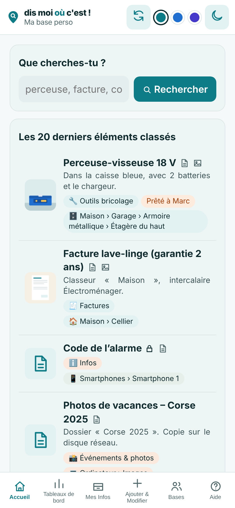 | 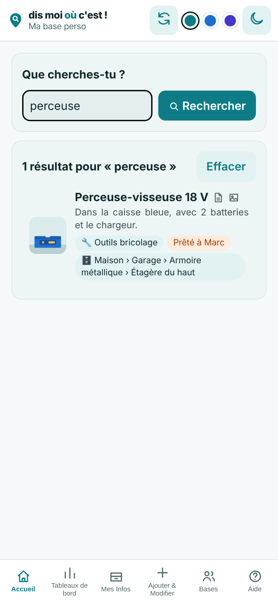 |

### La fiche et le formulaire
La fiche donne le chemin complet, les photos des lieux (pour reconnaître l'endroit), le prêt en cours. Le formulaire permet de tout modifier : catégories, emplacements, photos, son, prêt, valeur sensible.

| Fiche | Formulaire |
|:--:|:--:|
| 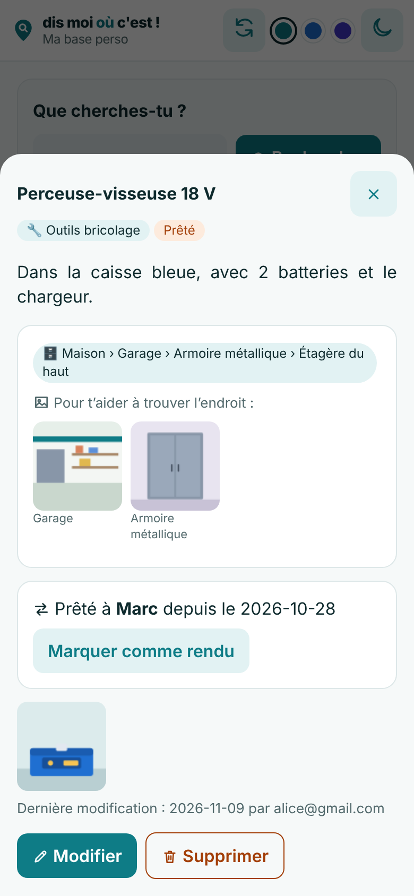 | 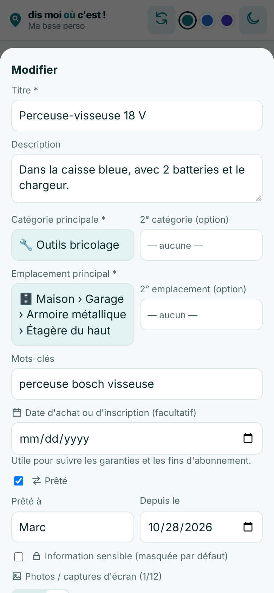 |

### Ajouter, classer, retrouver
« Ajouter & Modifier » réunit le bouton d'ajout et l'arbre des catégories et emplacements. « Mes Infos » propose liste, tableau, filtres et export CSV.

| Ajouter & Modifier | Mes Infos |
|:--:|:--:|
| 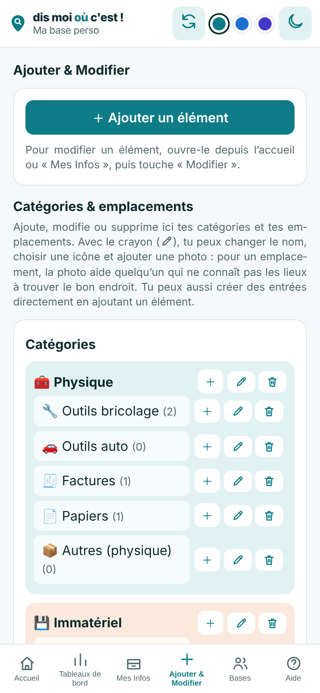 | 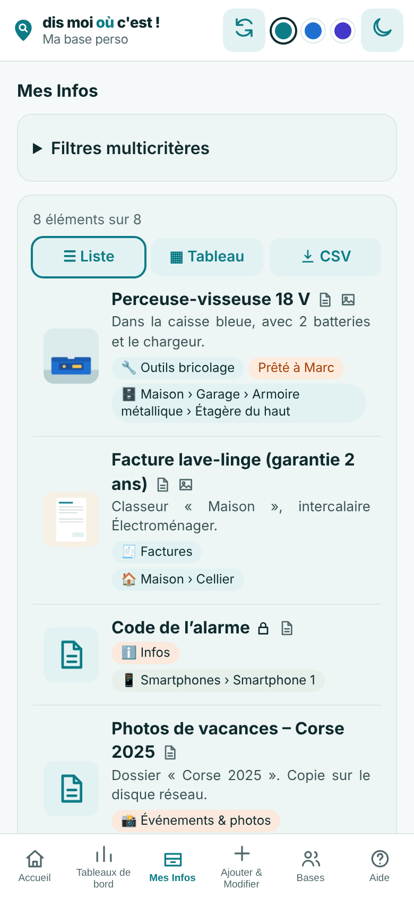 |

### Tableaux de bord, bases et aide

| Tableaux de bord | Bases et partage | Tutos |
|:--:|:--:|:--:|
| 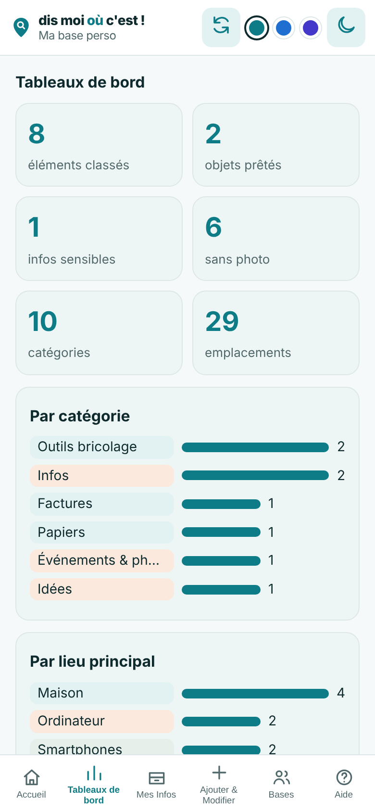 | 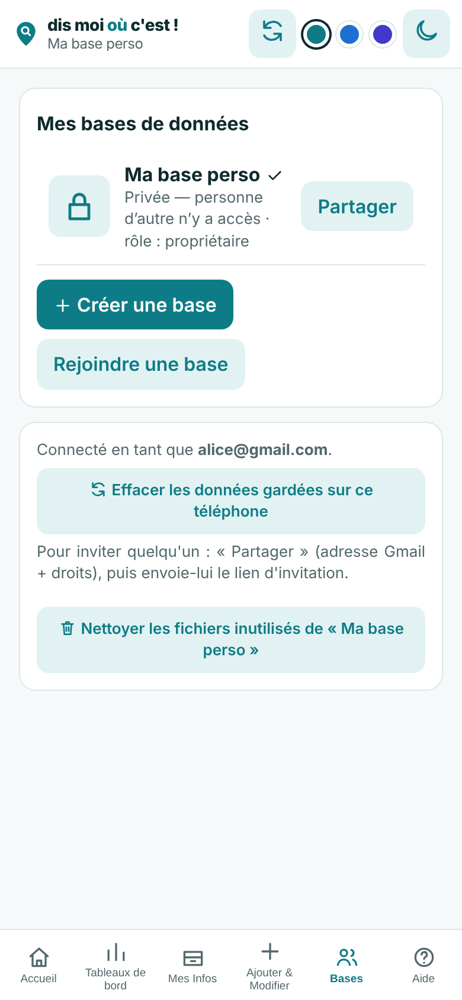 | 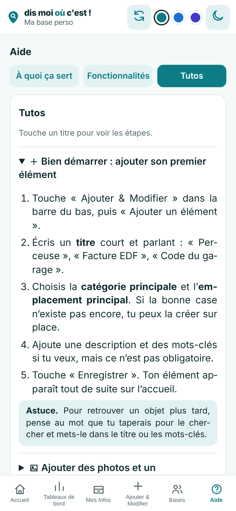 |

### 6 chartes, 3 couleurs, 2 modes : clair et sombre

| Océan sombre | Azur clair | Indigo sombre |
|:--:|:--:|:--:|
| 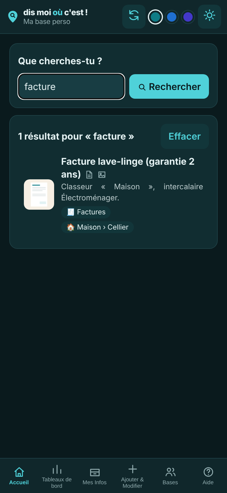 | 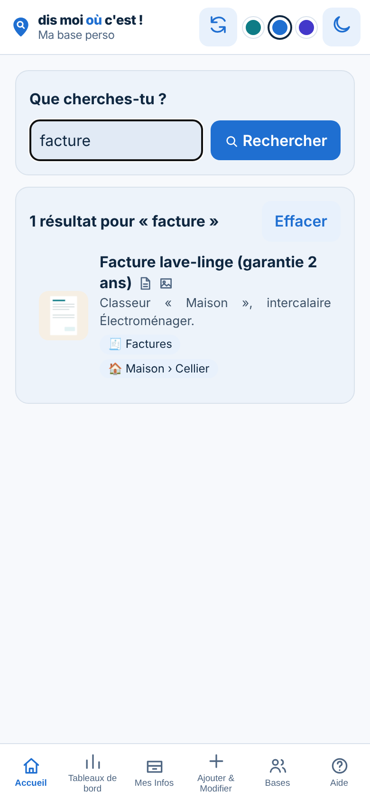 | 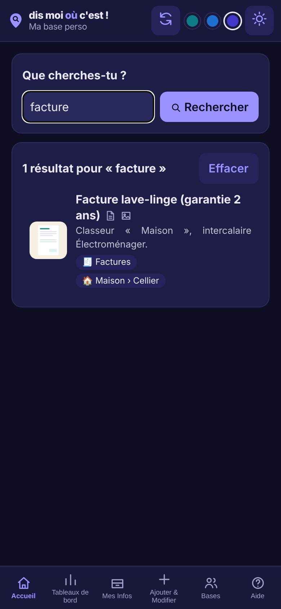 |

### Sur ordinateur
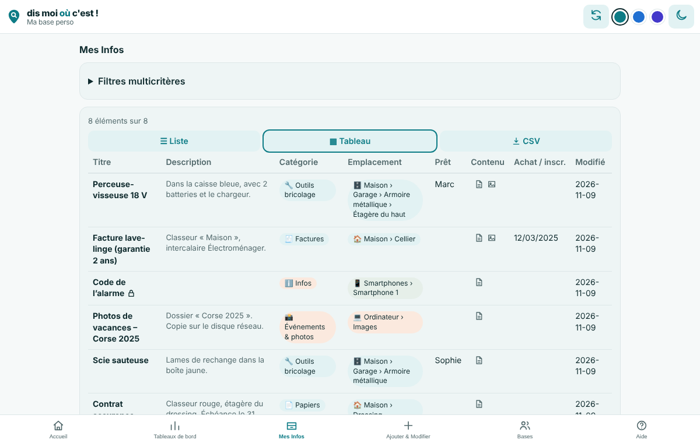

---

## Stack technique

| Brique | Rôle |
|---|---|
| **Google Apps Script** | Toute la logique côté serveur (JavaScript) et service de la page web |
| **Apps Script Web App** | Interface unique `index.html` (HTML / CSS / JavaScript), responsive, sans bibliothèque externe |
| **Google Sheets** | Une base = un classeur (onglets Elements, Categories, Emplacements, Config, Journal, Miniatures) |
| **Google Drive** | Un dossier par base pour les photos et les sons ; partage des droits ; e-mails d'invitation |
| **UserProperties / CacheService** | Liste des bases de l'utilisateur, cache serveur, préférences |
| **localStorage** | Cache local de l'interface, préférences de charte et brouillon |

**Pourquoi ce choix ?**
- **Gratuit** : tout tient dans un compte Google classique.
- **Les données restent chez chacun**, dans son Google Drive.
- **Aucun serveur à maintenir** ni hébergement.
- **Lisible et réparable** : la base est un simple tableur.

Limites connues : temps de réponse d'Apps Script (1 à 4 s par appel, compensé par une interface optimiste et un cache local), quotas Google, écran Google « application non vérifiée » pour les testeurs.

---

## Architecture

```
 Téléphone / PC (navigateur)
          │      index.html : une seule page, cache local
          ▼
 Application web Apps Script   (exécutée « en tant que l'utilisateur qui accède »)
          │
          ├──► Google Sheets  (une base = un classeur dans le Drive de l'utilisateur)
          ├──► Google Drive   (photos, sons, droits de partage, e-mail d'invitation)
          └──► Propriétés / cache (liste des bases, préférences)
```

Le détail (modèle de données, sécurité, performances) est dans [`docs/ARCHITECTURE.md`](docs/ARCHITECTURE.md).

---

## Organisation du dépôt

| Dossier | Contenu |
|---|---|
| `src/` | Fichiers Apps Script : `Code.gs` (point d'entrée), `Base.gs` (Sheet, éléments, arbres, cache), `Partage.gs` (bases, rôles, partage), `Drive.gs` (photos, sons), `index.html` (toute l'interface), `Diagnostic.html` (page de test du serveur, `…/exec?page=diag`), `appsscript.json` (manifeste) |
| `test/` | Simulateur Google (`mock.js`), 82 scénarios serveur (`scenarios.js`), test d'interface avec navigateur (`ui.js`), génération des captures (`captures.js`) |
| `captures/` | Captures d'écran de l'application (données fictives) |
| `assets/` | Logo, icône d'application, favicon (SVG et PNG) |
| `docs/` | Architecture, charte graphique, guide d'installation, Memory Bank du projet, brief logo/charte |

---

## Installer dans Apps Script

Le guide pas à pas est dans [`docs/INSTALLATION.md`](docs/INSTALLATION.md). En résumé :

1. Créer un projet sur <https://script.google.com> et y copier les fichiers de `src/` (ou utiliser `clasp push`).
2. Déployer → Nouveau déploiement → **Application web** : exécuter en tant que **l'utilisateur qui accède à l'application**, accès **tout le monde**.
3. À chaque modification : Déployer → Gérer les déploiements → ✏️ → **Nouvelle version**.

## Tests (sans Google)

```bash
npm install                       # installe Playwright (test d'interface seulement)
npm test                          # 82 scénarios serveur avec un simulateur Google
npx playwright install chromium
npm run test:ui                   # test de l'interface, captures dans test/shots/
npm run captures                  # régénère les captures du README dans captures/
```

---

## Sécurité et vie privée

- **Aucune donnée n'est publiée dans ce dépôt** : les données de chacun vivent dans son Google Drive.
- Exécution **en tant que l'utilisateur qui accède** : chacun n'accède qu'à ses propres bases et à celles qu'on lui a partagées.
- Le **rôle** (lecture / modification) est relu dans Drive à chaque écriture, côté serveur.
- Pièces jointes **limitées aux fichiers de l'application** ; cellules enregistrées en texte.
- Côté interface : tous les identifiants reçus du serveur sont validés (`/^[\w-]{1,80}$/`), aucune donnée utilisateur n'est insérée dans du code JavaScript, l'export CSV neutralise les formules.
- Les **informations sensibles** sont masquées, lues à la demande et jamais exportées.

## Règles importantes pour le code de la page

- **Jamais de `/*` ni de `//` dans une chaîne de caractères JavaScript** de `index.html` : Google supprime tout ce qui est entre `/*` et `*/` à l'envoi de la page (écrire par exemple `image/\x2a`).
- `index.html` est servi sans moteur de modèles ; seul `__INVITE__` est remplacé dans `Code.gs`.
- La prise de photo en direct est **volontairement retirée** : Android recharge la page à son retour.

---

## Feuille de route

- [x] Architecture, backend (Sheets + Drive), interface mobile et PC
- [x] Plusieurs bases, partage par e-mail, rôles lecture / modification
- [x] Photos, sons, prêts, informations sensibles, export CSV
- [x] Catégories et emplacements en arbre avec icônes et photos
- [x] Identité visuelle : logo, trois chartes clair / sombre, jeu d'icônes
- [x] Aide intégrée et 8 tutos
- [ ] Test avec un second compte, puis avec des amis testeurs
- [ ] Vérification sur iPhone
- [ ] Alertes de fin de garantie et d'abonnement, rappel de retour de prêt
- [ ] Étiquettes QR par emplacement
- [ ] Remplissage automatique à partir d'une photo, import CSV, recherche vocale, code-barres

---

## Droits

© 2026 Jean-François Madeline — OrdiNovice. Tous droits réservés tant qu'aucune licence n'est ajoutée.

## Contact

**Jeff Madeline** — OrdiNovice / IA+Simple
[iaplussimple.com](https://iaplussimple.com)
